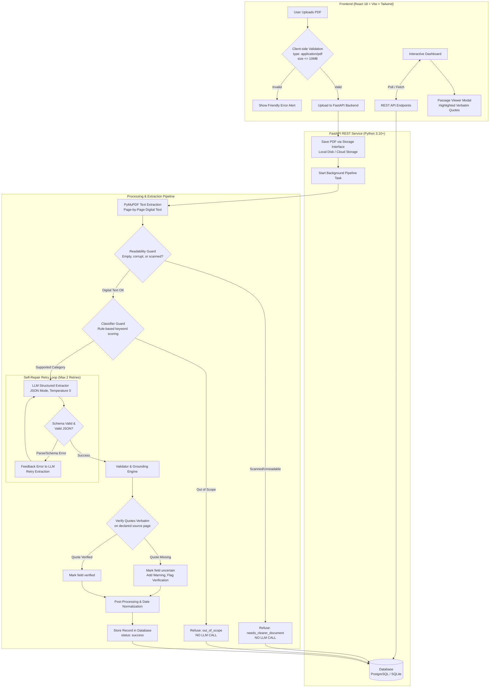

# Notice to Action 📑➡️⚡

> **Transforming confusing bureaucratic and administrative notices into clear, verified, actionable checklists with deadlines, reminders, and zero hallucinations.**

[](https://www.python.org/)
[](https://fastapi.tiangolo.com/)
[](https://react.dev/)
[](https://vitejs.dev/)
[](https://tailwindcss.com/)
[]()

---

## 1. Core Promise & Capabilities

Official notices—such as municipal property tax demands, scholarship renewal mandates, bank KYC circulars, utility disconnection warnings, and government welfare announcements—are frequently dense, multi-page PDFs written in complex administrative jargon. Citizens and students routinely miss critical deadlines, assemble incomplete document packages, or suffer financial surcharges simply because administrative notices are hard to decipher.

**Notice to Action** solves this problem by processing complex official PDF circulars and providing:

- **Prominent Deadlines with Active Countdowns**: Clear identification of primary cutoffs and submission windows.
- **Mandatory vs. Optional Checklists**: Explicit segregation of mandatory attachments (`is_required: true`) from optional or conditional forms.
- **Sequential Action Steps**: Chronologically ordered compliance instructions derived directly from notice text.
- **Evidence-Linked Verifiability ("See in Notice")**: Every critical claim is backed by a verbatim quotation and 1-indexed source page citation. Clicking "See in notice" opens the original page text with the cited passage highlighted.
- **Zero Hallucination & Null-on-Absence**: Missing information defaults strictly to `null` with status `"not_found"`. Dates and instructions are never estimated or invented.
- **Uncertainty & Ambiguity Warnings**: Ambiguous timelines (e.g. "within 15 days of circular receipt" without an anchor date) and conflicting dates trigger high-visibility warning banners.

---

## 2. In-Scope vs. Explicit Exclusions (PRD Section 2)

To maintain strict reliability and security boundaries, **Notice to Action** enforces clear operational scopes:

### Supported In-Scope Categories
1. **`tax_or_payment`**: Municipal property tax notices, assessment demands, advance tax alerts.
2. **`scholarship_or_college`**: Financial aid circulars, college renewal mandates, stipend applications.
3. **`bank`**: Account KYC refresh notices, dormancy warnings, re-KYC mandates.
4. **`utility`**: Electricity, water, or gas disconnection warnings, meter replacement notices.
5. **`government_scheme`**: Direct benefit transfer (DBT) registrations, subsidy application windows.

### Explicit PRD Exclusions
- **No Third-Party Form Submission**: The system never logs into portals, files forms, or submits applications on behalf of the user.
- **No Automated Payments**: The system does not execute banking transactions, card debits, or payment gateway triggers.
- **No Legal or Financial Advice**: The system extracts verbatim factual directives and provides no advisory interpretations.
- **No Image/Photo Uploads**: Only PDF documents (up to 10 MB) are accepted. Standalone JPEG/PNG files without a PDF wrapper are rejected.
- **No Handwritten or Password-Protected Documents**: Degraded handwritten circulars and encrypted PDFs are refused early with guidance to upload a clear digital document.
- **Language Scope**: English-language circulars only. Non-English circulars fall back to out-of-scope refusal.

---

## 3. System Architecture

The following architecture illustrates the end-to-end processing pipeline, from client-side PDF ingestion through early refusal gates, LLM extraction with self-repair, evidence grounding, database persistence, and presentation in the React dashboard:



---

## 4. Quickstart & Setup (Windows PowerShell)

### Prerequisites
- Python 3.10 or higher
- Node.js 18+ and npm
- Windows PowerShell (or Git Bash)

### Backend Setup

1. **Clone the repository and enter the directory**:
   ```powershell
   git clone <repo-url>
   cd Notice2Action
   ```

2. **Create and activate a virtual environment**:
   ```powershell
   python -m venv .venv
   .venv\Scripts\Activate.ps1
   ```

3. **Install Python dependencies**:
   ```powershell
   pip install -r backend/requirements.txt
   pip install -r requirements-dev.txt
   ```

4. **Initialize Environment Variables**:
   ```powershell
   Copy-Item .env.example .env
   ```
   *(Configure your `LLM_API_KEY` or `GEMINI_API_KEY` in `.env` if executing live extractions).*

5. **Initialize the Database**:
   ```powershell
   $env:DISABLE_SQLALCHEMY_C_EXTENSIONS="1"
   python scripts/create_tables.py
   ```

6. **Start the FastAPI Backend Server**:
   ```powershell
   $env:DISABLE_SQLALCHEMY_C_EXTENSIONS="1"
   python -m uvicorn backend.app.main:app --host 0.0.0.0 --port 8000 --reload
   ```
   *The interactive Swagger OpenAPI documentation is available at `http://localhost:8000/docs`.*

### Frontend Setup

1. **Enter the frontend directory and install npm packages**:
   ```powershell
   cd frontend
   npm install
   ```

2. **Configure Frontend Environment**:
   ```powershell
   Copy-Item .env.example .env
   ```
   *Ensure `VITE_API_BASE_URL=http://localhost:8000` is configured in `frontend/.env`.*

3. **Start the Vite Development Server**:
   ```powershell
   npm run dev
   ```
   *Open your browser and navigate to `http://localhost:5173`.*

---

## 5. Environment Variables Reference

| Variable Name | Default Value | Description |
|---|---|---|
| `DATABASE_URL` | `sqlite:///./notice2action.db` | SQLAlchemy database connection string (SQLite for local, PostgreSQL/Supabase for production). |
| `STORAGE_BACKEND` | `local` | File storage provider interface (`local` for disk storage, `supabase` for cloud object storage). |
| `UPLOAD_DIR` | `./uploads` | Private server directory for uploaded PDF storage (outside public web root). |
| `LLM_PROVIDER` | `gemini` | LLM client provider (`gemini`, `openai`, or `fake`). |
| `LLM_API_KEY` | *(None)* | API secret key for LLM provider (Google Gemini or OpenAI). |
| `LLM_MODEL` | `gemini-1.5-flash` | LLM model identifier. |
| `MAX_FILE_SIZE_BYTES`| `10485760` | Maximum upload file size in bytes (10 MB). |
| `VITE_API_BASE_URL` | `http://localhost:8000` | Backend API base URL consumed by React frontend client. |
| `DISABLE_SQLALCHEMY_C_EXTENSIONS` | `1` | Disables compiled C extensions on Windows systems with strict binary execution policies. |

---

## 6. Testing & Evaluation Harness Commands

### Running Backend & Extractor Unit Tests
Run the complete suite of 71 unit and integration tests across API routes, extraction pipelines, validators, and evaluation metrics:
```powershell
$env:DISABLE_SQLALCHEMY_C_EXTENSIONS="1"
python -m pytest -v
```

### Running Frontend Tests & Linting
Run component unit tests and ESLint in the `frontend/` directory:
```powershell
cd frontend
npm test
npm run lint
npm run build
cd ..
```

### Validating Ground-Truth Annotations
Verify that all test suite annotations conform strictly to JSON Schema and verify that all evidence quotes exist verbatim in the source PDFs:
```powershell
python scripts/validate_annotations.py
```

### Running the Evaluation Benchmark
Run the automated evaluation benchmark against ground-truth annotations in `data/annotations/`:

- **Deterministic Offline Evaluation** (No API key needed, uses reproducible canned models):
  ```powershell
  python evaluation/run_eval.py --fake
  ```

- **Live Evaluation with Real LLM**:
  ```powershell
  python evaluation/run_eval.py
  ```

- **Force Cache Refresh**:
  ```powershell
  python evaluation/run_eval.py --refresh
  ```

### Inspecting Benchmark Failures Side-by-Side
Display side-by-side expected vs. predicted comparisons with source passages for any failing notice:
```powershell
python scripts/show_failures.py
```

---

## 7. REST API Overview

All API endpoints are prefixed with `/api` and return standardized JSON error envelopes on failure:

- **Health Check**:
  - `GET /api/health` — Returns system status, storage configuration, and executes `SELECT 1` on the database.
- **Notice Ingestion**:
  - `POST /api/notices/upload` — Accepts multipart PDF upload; performs file safety validation and starts async extraction pipeline.
- **Notice Management**:
  - `GET /api/notices` — Lists all uploaded notices with status, category, and date.
  - `GET /api/notices/{id}` — Retrieves detailed notice record, extracted JSON result, and verification flags.
  - `DELETE /api/notices/{id}` — Removes notice database record and deletes stored PDF from disk.
- **Checklist Interactivity**:
  - `PATCH /api/notices/{id}/checklist/{item_index}` — Updates document checklist status (`completed`, `not_completed`, `needs_verification`).
- **Reminders**:
  - `GET /api/notices/{id}/reminders` — Lists reminders associated with notice.
  - `POST /api/notices/{id}/reminders` — Creates a new deadline reminder (`remind_on`, `note`).
  - `PATCH /api/reminders/{id}` — Updates reminder completion state (`done: true/false`).
  - `DELETE /api/reminders/{id}` — Deletes reminder record.
- **Passage Viewer**:
  - `GET /api/notices/{id}/pages/{page}` — Returns raw normalized text for specified 1-indexed page for client-side quote highlighting.

---

## 8. Benchmark Evaluation Results

All evaluation metrics are calculated objectively by `evaluation/run_eval.py` according to PRD Section 9 criteria. Raw model outputs are cached in `evaluation/cache/` and results are written to `evaluation/results/latest.json`.

> [!NOTE]
> Please refer to the full evaluation benchmark report at:
> **[evaluation/results/report.md](file:///c:/Users/user/Notice2Action/evaluation/results/report.md)**  
> This report contains honest, unedited measurements on the test suite (classification accuracy, deadline precision, required action recall, zero unsupported critical claims, and processing latency) without invented figures.

---

## 9. Known Limitations & Roadmap

- **OCR Scope**: Basic OCR fallback is provided via Tesseract when available; degraded, low-resolution handwritten notices are safely refused (`needs_clearer_document`).
- **Multilingual Support**: MVP scope is strictly English administrative circulars. Multi-language and regional dialect support (Hindi, regional state circulars) is planned for Phase 7.
- **Browser Push Notifications**: Reminders currently track scheduled dates within the application dashboard. Web Push and calendar `.ics` exports are slated for upcoming releases.

---

## 10. Contributors & License

Built with care by **Team Action4AI**.  
Licensed under the [MIT License](LICENSE).
