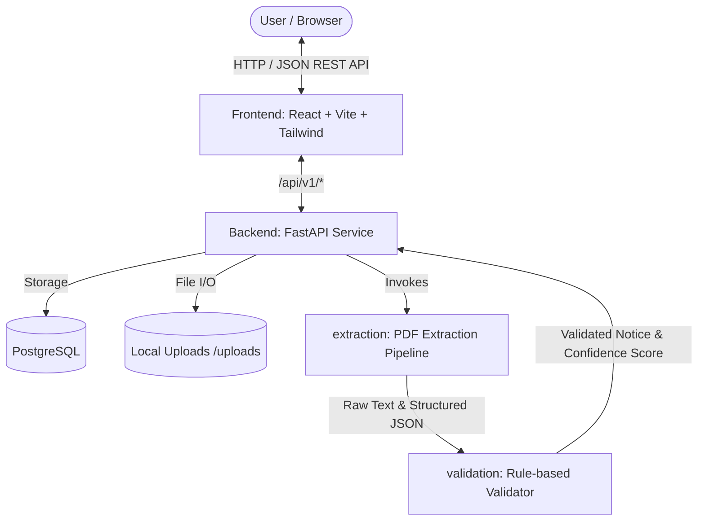

# Architecture Overview - Notice to Action

## 1. System Architecture

## 2. Monorepo Components & Ownership

| Component | Stack | Owner | Role & Responsibility |
|---|---|---|---|
| `frontend/` | React 18, Vite, Tailwind CSS | Member 3 | Responsive UI, evidence viewing, uncertainty badges, mock integration |
| `backend/` | Python 3.10+, FastAPI, SQLAlchemy, Alembic | Member 2 | REST endpoints, authentication/session, file validation, DB storage |
| `extraction/` | Python package, pdfplumber/tesseract/LLM | Member 1 | PDF text extraction, OCR fallback, prompt orchestration, schema extraction |
| `validation/` | Python package, jsonschema, fuzzy matching | Member 4 | Schema validation, quotation grounding check, benchmark evaluation runner |
| `schema/` | JSON Schema v1.0 | Shared (All 4) | Single source of truth defining data contract |
| `data/` | Raw (ignored), Masked, Annotations | Member 4 | Benchmarking dataset, edge-case notices, ground truth evaluation sets |
| `docs/` | Markdown | Member 4 / Team | PRD, evaluation reports, architecture diagrams |

## 3. Data Flow
1. **Upload**: User uploads PDF via `POST /api/v1/notices/upload`.
2. **Validation**: Backend checks MIME type (`application/pdf`) and size constraint (`MAX_UPLOAD_MB`).
3. **Extraction**: `extraction.process_pdf(file_path)` parses text pages and prompts LLM with strict v1 prompts.
4. **Verification**: `validation.validate_notice(extracted_json, page_texts)` enforces:
   - JSON schema compliance.
   - Quote existence in raw page texts.
   - Ambiguity detection.
5. **Storage**: Backend records result and returns schema-compliant JSON to frontend.
